# HALF SOUR — database schema

The whole company in one Postgres database: the storefront, the kitchen, the
marketing, and the AI staff that run most of it. One human operates it.

- **Migrations**: `supabase/migrations/*.sql`, applied in filename order.
- **Seed**: `supabase/seed.sql` — four months of a real business.
- **Verification**: `supabase/tests/run_local.sh` builds an empty database,
  applies everything, loads the seed and runs `supabase/tests/verify.sql`.

```
20260101000000_foundation.sql        domains, cross-cutting enums, helper functions
20260101000100_platform.sql          operators, admin_sessions, settings, audit_log
20260101000200_brand.sql             brand_assets, brand_rules
20260101000300_agents.sql            agents, runs, messages, tool calls, costs, approvals
20260101000400_commerce.sql          the Shopify mirror: catalogue, customers, carts, orders
20260101000500_shopify_sync.sql      webhook_events, sync_state
20260101000600_production.sql        suppliers, ingredients, recipes, batches, traceability
20260101000700_marketing.sql         social, content, campaigns, email, reviews
20260101000800_rls_grants_triggers.sql  RLS policies, grants, triggers, storefront RPC
20260101999900_schema_guarantees.sql    backfills anything missed, then asserts — sorts last
```

Several agents write migrations into this directory. `..._schema_guarantees.sql`
sorts last on purpose: a table added by any later migration still gets RLS, a
policy and its `updated_at` trigger, and the guarantees below are re-checked
over the _final_ schema rather than a snapshot of the middle of the run.

---

## The five decisions everything else follows from

### 1. Commerce is a mirror. Production is not.

Shopify is live (`sgu8sy-at.myshopify.com`, NZD, Pacific/Auckland) and it owns
the catalogue, the customers and the money. Twelve commerce tables mirror it:
`products`, `product_variants`, `product_images`, `collections`,
`inventory_locations`, `inventory_levels`, `customers`, `addresses`,
`discounts`, `carts`, `orders`, `subscriptions`. Each carries the same block:

```sql
provider           commerce_provider  -- 'shopify' | 'local'
shopify_gid        text               -- nullable, unique
shopify_updated_at timestamptz        -- Shopify's clock, not ours
sync_status        sync_status        -- local | pending | synced | stale | failed
synced_at          timestamptz
sync_error         text
```

Everything that Shopify _cannot_ do — recipes, batches, ingredients, suppliers,
purchase orders, agents, approvals, brand rules, the audit log — is owned
outright here, with no provider column at all. That asymmetry is the reason this
database exists rather than a Shopify app.

**Idempotent upsert.** Webhooks arrive at-least-once and out of order, so the
mirror never trusts arrival order:

```sql
insert into products (shopify_gid, title, status, shopify_updated_at, ...)
values (...)
on conflict (shopify_gid) do update set ...
where excluded.shopify_updated_at >= products.shopify_updated_at;
```

Last-writer-wins on _Shopify's_ `updated_at`. A duplicate delivery is a no-op; a
late delivery loses to the newer state it would otherwise undo. The unique index
on `shopify_gid` is what makes the `on conflict` clause possible, and it is the
single constraint the whole ingest leans on.

Four checks are applied to every mirrored table by one loop in the commerce
migration, so the rule is written once and cannot drift table to table:

| invariant                                                                 | why                                                                 |
| ------------------------------------------------------------------------- | ------------------------------------------------------------------- |
| `(provider = 'local') = (sync_status = 'local')`                          | the discriminator cannot lie                                        |
| a local row carries no `shopify_gid`, `synced_at` or `shopify_updated_at` | mock rows have no Shopify identity                                  |
| `sync_status = 'synced'` requires a gid **and** a `synced_at`             | a row cannot claim to be current with nothing to be current against |
| gids match `gid://shopify/<Type>/<id>`                                    | catches a raw numeric id passed where a gid belongs                 |

**`shopify_gid` is nullable everywhere.** The test suite runs against a mock
provider with no Shopify credentials: it writes `provider = 'local'`,
`sync_status = 'local'`, and every table works standalone.

**Money.** Shopify returns decimal strings (`"18.00"`). Converting those to
integer cents is the adapter's job. Nothing in this schema stores a decimal
price.

**`webhook_events`** records every event _before_ anything acts on it, keyed by
Shopify's `X-Shopify-Webhook-Id` (`shopify_event_id`, NOT NULL UNIQUE). The
receiver inserts and treats a unique violation as "already have it, ack and move
on". A handler bug is then a fixable bug rather than lost data, because the
payload is still sitting there to replay.

**`sync_state`** holds one row per `(provider, shop, resource)`: the GraphQL
`cursor` for a backfill in flight, and `high_water_mark` — the newest Shopify
`updated_at` successfully ingested, which becomes `updated_at_min` on the next
reconciliation sweep so a resumed run never re-reads the whole catalogue.

### 2. One approvals object, not one queue per feature

`approvals` is the single human-in-the-loop table. Social posts, reorders, price
changes, outreach emails, batch releases, refunds and review replies all land in
it. The admin's inbox is one query:

```sql
select * from approvals where status = 'pending' order by risk desc, requested_at;
```

`subject_id uuid` is deliberately untyped — a typed FK per subject would mean
seventeen nullable columns and seventeen queues. `subject_table` carries the
table name for generic joins, and `payload jsonb` holds the **exact mutation to
perform on approval**, so the applier replays a decision rather than re-deriving
it. That is what makes approving idempotent.

A partial unique index enforces one open ask per thing:

```sql
create unique index approvals_one_pending_per_subject
  on approvals (subject_type, subject_id)
  where status = 'pending' and subject_id is not null;
```

An agent that retries cannot flood the queue. And the state machine cannot lie:
pending rows carry no decision, decided rows carry a timestamp, `applied_at`
requires `status = 'approved'` and must be at or after the decision, and
anything with more than NZ$50 attached cannot be filed as low risk.

The requirement is enforced at the far end too, in the tables that _do_ things:
`social_posts` cannot be scheduled or published by an agent without an
`approval_id`; a cold-outreach `email_sends` row cannot leave `draft` without
one; an agent-written review reply cannot exist without one; a
`purchase_order` in `pending_approval` must name the approval it is waiting on.
Those are check constraints, not conventions.

### 3. Batch-to-order traceability is structural

The Food Act 2014 requires a food business to trace product one step forward and
one step back and to withdraw a defined lot on demand. So the forward link is
modelled properly rather than as a convenience join.

`order_item_batches` carries `product_id` on the row purely so it can be pinned
by **both** composite foreign keys at once:

```sql
foreign key (order_item_id, product_id) references order_items (id, product_id),
foreign key (batch_id,      product_id) references batches     (id, product_id)
```

The product must agree on both sides or the row will not insert. Tracing a
No 03 SMOKE batch onto a No 01 HOUSE order line is not a bug that gets caught in
review; it is a write that Postgres refuses. (`verify.sql` proves it.)

The recall query is then one join:

```sql
select o.order_number, o.email, oib.quantity
  from order_item_batches oib
  join order_items oi on oi.id = oib.order_item_id
  join orders o on o.id = oi.order_id
 where oib.batch_id = :recalled_batch;
```

Backwards, `batch_ingredients.supplier_lot_code` answers "whose dill was it",
and links to the `purchase_order_items` line it was received on.

`recipes` are versioned and never edited in place: a change is a new row with
`version + 1`, `supersedes_recipe_id` pointing back, and a mandatory
`change_note`. `batches.recipe_id` points at the exact version it was made from,
so changing a recipe can never rewrite the history of what was already bottled.
A partial unique index allows exactly one `is_current` version per recipe slug.

### 4. Money is integer minor units. Always.

Every money column is a `_cents` integer. No `numeric`, no `float`, no
`money` type. Percentages are integer basis points (`_bp`) — a 10% discount is
`value_bp = 1000`, so a discount calculation is integer arithmetic end to end
and no float ever touches a price.

The one exception proves the rule: token spend is far below one cent per call,
so `agent_costs.cost_micros` and `agent_runs.cost_micros` are `bigint` millionths
of one NZD — still integer minor units, just at higher resolution — with a
generated `cost_cents` column for the dashboards.

`numeric` **is** used, for quantities: `ingredients.stock_on_hand`,
`recipe_ingredients.quantity`, `batches.yield_litres`, `batches.ph_reading`.
Those are measurements in a `unit_of_measure`, never prices.

Every timestamp is `timestamptz`. There is no naive `timestamp` column in the
schema, and migration `...0800` fails if one ever appears.

### 5. RLS on with no policy is a locked door, not a secure one

Three callers exist:

| role            | who                                        | what it can reach                                                                                                                                                                                                                                 |
| --------------- | ------------------------------------------ | ------------------------------------------------------------------------------------------------------------------------------------------------------------------------------------------------------------------------------------------------- |
| `anon`          | the public storefront                      | active products, their variants, images, published collections, stock levels, published reviews, public brand assets and public settings. Its own cart, by bearer token. Its own order, by the same token. It may submit a review for moderation. |
| `authenticated` | the founder in the admin                   | everything, gated on `is_operator()`                                                                                                                                                                                                              |
| `service_role`  | the agent runtime and the webhook receiver | bypasses RLS by design; still needs grants                                                                                                                                                                                                        |

`is_operator()` is a `SECURITY DEFINER` function that reads the `operators`
table — authorisation is a row, not a hardcoded email, which is what lets a
policy on `operators` itself call it without recursing.

**The cart is bearer-authenticated.** An anonymous shopper has no user id, so
the client mints a 64-hex token and sends it as `x-cart-token` on every request.
`current_cart_token()` reads it out of PostgREST's `request.headers` GUC and the
cart policies match on it. Order confirmation works the same way: a shopper can
read back the order their cart became, and nothing else about orders.

Storefront writes are narrowed by `WITH CHECK` rather than trusted: a submitted
review must be `status = 'pending'`, cannot award itself a verified-purchase
badge, cannot carry the brand's reply, and cannot arrive pre-published. A
shopper updating their own cart cannot set `converted_order_id` — checkout runs
server-side under `service_role`.

Discount codes are validated without exposing the `discounts` table at all:
`validate_discount_code()` is `SECURITY DEFINER` and returns only what a checkout
needs.

RLS decides _which rows_; grants decide _which verbs_. Both are set, not either:
`anon` is revoked from every table and then granted back exactly thirteen.
`audit_log` and `agent_messages` are append-only at the grant level as well as
the policy level — RLS does not filter `TRUNCATE`.

---

## The migrations verify themselves

The last migration backfills anything a later migration left out, then runs six
`DO` blocks that **raise and fail the migration** rather than merely reporting.
If any of these is ever untrue, the schema does not ship:

1. every table in `public` has RLS enabled **and** at least one policy
2. every foreign key is served by a non-partial index whose leading columns are
   exactly the FK columns
3. no money column is `float`/`numeric`/`money`, and no column is a naive
   `timestamp`
4. every table carrying `updated_at` has the trigger attached
5. `anon` holds no privilege on any back-office table — and any `anon` grant
   without a matching `anon` policy is revoked, because a grant nobody wrote a
   policy for is an accident rather than a decision
6. every mirrored table (one carrying both `shopify_gid` and `sync_status`)
   still has its `synced_has_identity` check

Current state, from a clean build:

```
rls_enabled | rls_missing | policies_missing | tables_total | policies_total
         50 |           0 |                0 |           50 |             73

NOTICE:  PASS: every public table has RLS enabled and at least one policy.
NOTICE:  PASS: all 116 foreign keys are covered by an index.
NOTICE:  PASS: no float/numeric money, no naive timestamps.
NOTICE:  PASS: 41 tables carry the updated_at trigger.
NOTICE:  PASS: anon holds no privilege on any back-office table.
```

`updated_at` triggers are attached by a loop over every table that carries the
column, so a table added later cannot silently miss one — and check 4 proves it.

---

## Entity relationships

```mermaid
erDiagram
    OPERATORS ||--o{ ADMIN_SESSIONS : "signs in"
    OPERATORS ||--o{ APPROVALS : decides
    OPERATORS ||--o{ AGENTS : "runs as"

    AGENTS ||--o{ AGENT_RUNS : performs
    AGENT_RUNS ||--o{ AGENT_MESSAGES : transcript
    AGENT_RUNS ||--o{ AGENT_TOOL_CALLS : "tool use"
    AGENT_RUNS ||--o{ AGENT_COSTS : spends
    AGENT_RUNS ||--o{ APPROVALS : raises
    APPROVALS ||--o| AGENT_RUNS : blocks

    BRAND_RULES }o--o| BRAND_ASSETS : illustrates
    AGENTS }o--o{ BRAND_RULES : "reads before writing"

    PRODUCTS ||--o{ PRODUCT_VARIANTS : has
    PRODUCTS ||--o{ PRODUCT_IMAGES : shows
    PRODUCTS ||--o{ COLLECTION_PRODUCTS : "listed in"
    COLLECTIONS ||--o{ COLLECTION_PRODUCTS : contains
    PRODUCT_VARIANTS ||--o{ INVENTORY_LEVELS : "stocked at"
    INVENTORY_LOCATIONS ||--o{ INVENTORY_LEVELS : holds
    PRODUCT_VARIANTS ||--o{ INVENTORY_ADJUSTMENTS : "moved by"

    CUSTOMERS ||--o{ ADDRESSES : "ships to"
    CUSTOMERS ||--o{ ORDERS : places
    CUSTOMERS ||--o{ SUBSCRIPTIONS : holds
    SUBSCRIPTIONS ||--o{ SUBSCRIPTION_ITEMS : repeats
    CARTS ||--o{ CART_ITEMS : holds
    CARTS ||--o| ORDERS : "converts to"
    ORDERS ||--o{ ORDER_ITEMS : contains
    ORDER_ITEMS }o--|| PRODUCT_VARIANTS : "of variant"
    DISCOUNTS ||--o{ DISCOUNT_REDEMPTIONS : "used on"
    ORDERS ||--o{ DISCOUNT_REDEMPTIONS : redeems

    SUPPLIERS ||--o{ INGREDIENT_SUPPLIERS : quotes
    INGREDIENTS ||--o{ INGREDIENT_SUPPLIERS : "sourced from"
    SUPPLIERS ||--o{ PURCHASE_ORDERS : fulfils
    PURCHASE_ORDERS ||--o{ PURCHASE_ORDER_ITEMS : orders
    PURCHASE_ORDER_ITEMS ||--o{ BATCH_INGREDIENTS : "received as"

    RECIPES ||--o{ RECIPE_INGREDIENTS : specifies
    RECIPES ||--o| RECIPES : supersedes
    INGREDIENTS ||--o{ RECIPE_INGREDIENTS : "used in"
    RECIPES ||--o{ BATCHES : "made from"
    PRODUCTS ||--o{ BATCHES : produces
    BATCHES ||--o{ BATCH_INGREDIENTS : "consumed lots"
    INGREDIENTS ||--o{ BATCH_INGREDIENTS : "lot of"
    BATCHES ||--o{ ORDER_ITEM_BATCHES : "shipped in"
    ORDER_ITEMS ||--o{ ORDER_ITEM_BATCHES : "filled from"

    SOCIAL_ACCOUNTS ||--o{ SOCIAL_POSTS : publishes
    CAMPAIGNS ||--o{ SOCIAL_POSTS : "part of"
    CAMPAIGNS ||--o{ EMAIL_SENDS : "part of"
    SOCIAL_POSTS ||--o{ SOCIAL_POST_ASSETS : uses
    CONTENT_ASSETS ||--o{ SOCIAL_POST_ASSETS : "used by"
    PRODUCTS ||--o{ REVIEWS : reviewed
    CUSTOMERS ||--o{ REVIEWS : writes
    APPROVALS ||--o{ SOCIAL_POSTS : gates
    APPROVALS ||--o{ EMAIL_SENDS : gates
    APPROVALS ||--o{ PURCHASE_ORDERS : gates
    APPROVALS ||--o{ REVIEWS : "gates reply"
    APPROVALS ||--o{ BATCHES : "gates release"

    WEBHOOK_EVENTS }o--o| ORDERS : "mirrors into"
    AUDIT_LOG }o--o| AGENT_RUNS : "written by"
    SETTINGS ||--o| OPERATORS : "edited by"
```



---

## Table reference

### Platform (4)

| table            | notes                                                                                                                                                                                                                                             |
| ---------------- | ------------------------------------------------------------------------------------------------------------------------------------------------------------------------------------------------------------------------------------------------- |
| `operators`      | Admin identities. `user_id` links to Supabase auth on first sign-in — a trigger on `auth.users` claims the seeded row by email, so "seed the founder, then sign up" works with no manual UPDATE.                                                  |
| `admin_sessions` | Server-side, revocable. Stores `session_token_hash`, never the token.                                                                                                                                                                             |
| `settings`       | Key/value config. `is_public` rows are readable by the storefront; `is_secret` rows hold vault key _names_, never secrets, and cannot also be public.                                                                                             |
| `audit_log`      | Append-only (`bigint` identity). `actor_id` and `agent_run_id` are deliberately **not** FKs: audit rows must outlive the accounts and runs they describe. It is the only soft reference in the schema and is documented as such in the migration. |

### Brand (2)

`brand_assets` (logos, colours, typefaces, shot library — a colour asset is
defined by its hex and nothing else, enforced by a check) and `brand_rules`, the
machine-readable style constraints. Agents read
`select rule from brand_rules where is_active order by priority` into their
system prompt, so editing a row changes agent behaviour with no deploy. A
`severity = 'never'` rule must carry `keywords`, because that is the blocklist a
deterministic pre-flight check runs before a caption ever reaches a queue.

### The AI company (6)

| table              | notes                                                                                                                                                                                                                                    |
| ------------------ | ---------------------------------------------------------------------------------------------------------------------------------------------------------------------------------------------------------------------------------------- |
| `agents`           | One row per role. `autonomy` (`observe`/`propose`/`act_with_limits`/`autonomous`) plus `requires_approval_for approval_subject[]` and spend caps decide what runs unattended. A `propose` agent with an empty approval list is rejected. |
| `agent_runs`       | Status/time consistency is enforced both ways: a terminal run has `finished_at`, a live one does not, a failed one has an error, and a run in `awaiting_approval` must name the approval blocking it. `duration_ms` is generated.        |
| `agent_messages`   | The transcript, append-only, unique on `(run_id, seq)`. A `tool` message must name its tool.                                                                                                                                             |
| `agent_tool_calls` | Arguments and results as `jsonb`, `is_mutation` flag, and a `rejected` call must name the approval that stopped it.                                                                                                                      |
| `approvals`        | See above.                                                                                                                                                                                                                               |
| `agent_costs`      | Per run, per model, per day. `cost_micros bigint` + generated `cost_cents`.                                                                                                                                                              |

### Commerce (18)

Catalogue (`products`, `product_variants`, `product_images`, `collections`,
`collection_products`), inventory (`inventory_locations`, `inventory_levels`
with a generated `available = on_hand - committed`, and `inventory_adjustments`
as the movement ledger that explains the running total), people (`customers`,
`addresses`), and the money path (`discounts`, `carts`, `cart_items`, `orders`,
`order_items`, `discount_redemptions`, `subscriptions`, `subscription_items`).

Composite foreign keys make several classes of nonsense unwritable:

| constraint                                                                       | prevents                                                |
| -------------------------------------------------------------------------------- | ------------------------------------------------------- |
| `order_items (variant_id, product_id) → product_variants (id, product_id)`       | a line for a variant that is not on that line's product |
| `order_items (order_id, currency) → orders (id, currency)`                       | a line priced in a currency the order is not in         |
| `cart_items`, `subscription_items`                                               | the same two, for baskets and standing orders           |
| `customers (default_address_id, id) → addresses (id, customer_id)`               | a customer defaulting to somebody else's address        |
| `subscriptions (shipping_address_id, customer_id) → addresses (id, customer_id)` | shipping a subscription to a stranger                   |
| `product_images (variant_id, product_id) → product_variants (id, product_id)`    | an image pinned to a variant of a different product     |
| `reviews (variant_id, product_id) → product_variants (id, product_id)`           | reviewing a variant of a product you did not review     |

And check constraints keep the invoice honest:

```sql
total_cents = subtotal_cents - discount_cents + shipping_cents
              + (case when tax_inclusive then 0 else tax_cents end)
```

NZ pricing is GST-inclusive, so `tax_cents` is the GST component already inside
`total_cents` rather than something added on. `line_total_cents = quantity *
unit_price_cents - discount_cents`. `refunded_cents > 0` and the financial status
must agree in both directions. `delivered` and `delivered_at` imply each other.
A cancelled order has a reason. A tracking number has a carrier.

`orders.order_number` comes from a sequence (`HS-01001`), so it is human-readable
and gap-tolerant.

### Shopify sync (2)

`webhook_events` and `sync_state`, described above. Both are empty and inert
under the mock provider.

### Production (10)

`suppliers` (with `food_safety_expires_on`, which a named programme requires, so
an expiring certificate is a queryable flag rather than a memory),
`ingredients`, `ingredient_suppliers` (one preferred supplier per ingredient,
enforced by a partial unique index), `recipes` + `recipe_ingredients`,
`batches` + `batch_ingredients`, `order_item_batches`, and
`purchase_orders` + `purchase_order_items`.

`batches` is where the food-safety rules live as constraints:

- time only runs forwards: `bottled_at ≥ produced_at`, `released_at ≥ bottled_at`
- **a batch cannot expire before it was made**: `expires_at > produced_at`
- nothing ships without a pass: `status = 'released'` requires `qa_passed`,
  a `released_at` and an `expires_at`
- `units_remaining ≤ units_produced - units_rejected`, and `sold_out` means zero
- a recalled batch must carry its reason
- `batch_code` matches `HS-<sku>-<YYMMDD>-<run>`; `total_cost_cents` and
  `unit_cost_cents` are generated from the four cost components

### Marketing (7)

`social_accounts` (access tokens are a `credential_ref` vault key name, never a
token; an active account must actually be connected), `content_assets`,
`campaigns`, `social_posts`, `social_post_assets`, `email_sends`, `reviews`.

`social_posts (account_id, platform) → social_accounts (id, platform)` is another
composite FK: a post cannot claim a platform its account is not on.

---

## Indexing

116 foreign keys, all covered — the migration fails otherwise. On top of that,
indexes follow the queries the admin actually runs:

- **Queues**: `approvals (risk desc, requested_at) where status = 'pending'`;
  `social_posts (scheduled_for) where status in ('scheduled','pending_approval')`;
  `reviews (created_at) where status = 'pending'`;
  `orders (fulfillment_status, placed_at) where status = 'open'`.
- **Recall**: `order_item_batches (batch_id, product_id)` and
  `batch_ingredients (supplier_lot_code) where not null` — both directions of the
  traceability chain.
- **Reorder sweep**: `inventory_levels (location_id, available) where reorder_point > 0`;
  `ingredients (stock_on_hand) where is_active and reorder_point > 0`.
- **Expiry sweep**: `batches (expires_at) where status in ('released','qa_hold')`.
- **Sync**: a unique index on `shopify_gid` per mirrored table (the upsert
  target), plus `(synced_at nulls first) where sync_status in ('pending','stale','failed')`
  as the resync queue, and `webhook_events (coalesce(triggered_at, received_at))
where process_status in ('received','failed')` as the work queue.
- **Search**: a generated `tsvector` on `products` with a GIN index, and GIN
  indexes on every `text[]` tag column.
- **Sorting**: `orders (placed_at desc)`, `(total_cents desc)`,
  `customers (total_spent_cents desc)`, `agent_costs (agent_id, incurred_on desc)`.

---

## Seed data

`supabase/seed.sql` is a working four-month-old business, not a fixture. It
truncates what it owns first, so it is safe to re-run, and every timestamp is
relative to `now()` so the store looks current whenever it is loaded.

- **The real catalogue**: No 01 HOUSE (NZ$18.00), No 02 DIRTY (NZ$20.00),
  No 03 SMOKE (NZ$22.00) and The Full Set (NZ$54.00), all 500ml, carrying their
  live Shopify product gids and the real `The Brines` collection gid.
- **95 orders** across four months with a believable curve — 1, then 11, 16, 31
  and 36 by calendar month — including the spike that followed the Brass and
  Bitters feature, two unpaid trade invoices, two part refunds and one
  cancellation traced to carrier damage. NZ$18,317.70 gross, NZ$16,893.00
  collected.
- **50 customers** across Auckland, Wellington, Christchurch, Dunedin, Tauranga,
  Hamilton, Napier and Queenstown, with the LTV spread you would actually see:
  six trade accounts at the top, seven devoted repeat buyers, twenty-six
  one-timers and two who have only ever signed up to the newsletter. Lifetime
  totals are **derived from the order book**, never typed, so they cannot drift.
- **18 batches** across eight versioned recipes, several sold through, one
  fermenting, one on the filler, and one with 22 bottles left and thirty days to
  best-before — which is exactly the thing the admin should be shouting about.
  **135 traceability links** connect them to the order lines they shipped in.
- **24 ingredients, 7 suppliers** — a produce co-operative, a spice importer, a
  Mediterranean importer, a salt works, a vinegar works, a glassware supplier and
  a label printer, with lead times and reorder points. Two ingredients are below
  their reorder point right now (500ml bottles and fresh dill), which is what put
  a NZ$2,917.00 purchase order into the approvals queue.
- **Four pending approvals** of genuinely different shapes, from four different
  agents, plus four decided ones including a rejection with the founder's reason.
- **Eight webhook events**, one of them parked after refusing to invent a
  product row for a variant the mirror has never seen, and the `sync_state` row
  that has failed three times because of it.

There is no lorem ipsum, no "Test Customer", no sequential emails, and — as a
hard rule — no health, nutrition or medical language anywhere in the customer-
facing copy. The only place those words appear at all is the `no-health-claims`
brand rule, where they are the blocklist that keeps them out.

---

## Running it

```bash
supabase/tests/run_local.sh          # empty db -> migrations -> seed -> verify
DB=half_sour_ci supabase/tests/run_local.sh
```

`supabase/tests/local_supabase_shim.sql` recreates just enough of a Supabase
project (the `auth` schema, `auth.uid()`, and the `anon` / `authenticated` /
`service_role` roles) for the migrations to apply to a bare Postgres. It is not
a migration and is never deployed — on a real project all of it already exists.

`verify.sql` re-runs the five acceptance checks, then demonstrates the security
model by switching roles and counting what each caller can actually see, tries
five writes that ought to be impossible and confirms the database refuses all
five, and finishes with the recall query and the admin's "needs attention" list.
